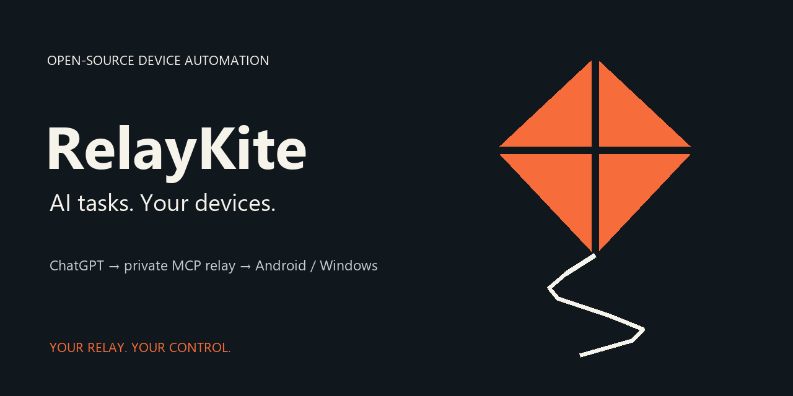

# RelayKite — AI tasks. Your devices.



**Let ChatGPT tap, swipe and run tasks on your devices.**

Control your Android phone and Windows PC through your own private MCP relay.

[Website](https://stervakim.github.io/relaykite/) · [Download v0.2.5](https://github.com/Stervakim/relaykite/releases/tag/v0.2.5) · [Android setup](docs/install-android.md) · [Windows setup](pc/README.en.md) · [Русский](README.ru.md)

RelayKite gives your AI assistant a way to act on the devices you own. Ask it to inspect your phone, open an app, work with files, or run an authorized PowerShell task on your PC. ChatGPT plans the task; a local agent carries it out and returns the result.

**The Android agent runs on the phone itself.** After setup, everyday phone control does not require a permanently running computer, USB or desktop ADB. The Windows agent runs independently on its own PC. Both need internet and your private relay.

Previously **Codaki Mini Codex**. This is the same project and v0.2.5 release under a new public name. Existing ZIP names, module IDs, tool names, credentials and installation paths retain their legacy names for compatibility.

## What is it for?

Use RelayKite when you want a conversation to lead to an action on your own device:

| You ask | The device agent can do |
| --- | --- |
| “Check my phone's battery and available storage.” | Return device status and inspect storage through available tools. |
| “Open Settings and tell me what is on the screen.” | Launch the app, read the UI or capture a screenshot. |
| “Save this note in my chosen folder.” | Write a file within the configured access. |
| “Diagnose why my phone agent stopped.” | Inspect relevant services and reuse saved maintenance notes. |
| “List large files in this Windows folder.” | Run an authorized PowerShell task on the connected PC. |

These are example requests, not recorded demos. Actual results depend on your device, configured permissions and available tools.

## Choose your device

| | Android | Windows |
| --- | --- | --- |
| Local worker | Python in Termux | Python background agent + PowerShell |
| Requirements | Existing root, Magisk and Termux with Python | Python 3.14+, PowerShell and selected permissions |
| Connection | Your authenticated HTTPS MCP relay and supported ChatGPT plugin | Your authenticated HTTPS MCP relay and supported ChatGPT plugin |
| Does it need the other device? | No permanently running PC after setup | No phone required |
| Install | `mini-codex-magisk-0.2.5.zip` | `mini-codex-pc-0.2.5.zip` |
| Guide | [Android installation](docs/install-android.md) | [Windows installation](pc/README.en.md) |

## How it works

```text
You → ChatGPT → your personal plugin → your private HTTPS relay
                                                ↕
                                    Local device agent
                                    Android or Windows
                                                ↓
                                    Action → result → chat
```

The model runs in your active ChatGPT conversation. RelayKite supplies device tools and a job system; it does not run a separate background language model. Memory stores notes and verified solutions between tasks; it does not train model weights. [Architecture and private relay setup](docs/deploy-private-relay.md).

## Get started

1. **Check the requirements.** Android needs root/Magisk and Termux already installed; Windows needs Python 3.14+ and PowerShell. Check that your ChatGPT account supports the required personal plugin connection.
2. **Download the right installer and `SHA256SUMS`** from [release v0.2.5](https://github.com/Stervakim/relaykite/releases/tag/v0.2.5). Check the SHA-256 checksum before installation.
3. **Follow the guide for your device.** Configure your own private relay and credentials, then connect your personal plugin. Importing a public card alone does not connect your device.
4. **Verify with a small task.** Start with device status, inspect a test app or list a test folder, and check the actual result.

For assisted installation, give Codex the release ZIP and checksum file:

> Install RelayKite v0.2.5 from this ZIP on my chosen device. Read INSTALL_WITH_CODEX.md, verify SHA256SUMS and requirements, configure my own private relay, and verify the connection. Use the device tools available to you. Preserve existing credentials, pairings, permissions, memory and logs during an update.

Initial Android preparation may need a computer. The installer does not install root or enable unavailable account features. [Compatibility](docs/compatibility.md) · [Access and data](docs/security.md).

## Release 0.2.5

This release includes recovery after Android agent failure, single-instance protection and optional loopback proxy configuration. Advanced integrations include optional external memory, code-map queries and Portable Use tools that require their corresponding runtimes. They are not prerequisites for understanding the basic device-agent flow.

[Changelog](CHANGELOG.md) · [Boot and proxy guide](docs/resilient-boot.md) · [Optional memory runtime](agent/memory-runtime/README.md) · [Portable session instructions](chatgpt/plugin/skills/using-codaki-phone-use/SKILL.md)

## Learn, verify and contribute

- [Control Android from ChatGPT without a running PC](https://stervakim.github.io/relaykite/guides/android-without-pc/) — how the architecture works and how to check it.
- [Windows guide](pc/README.en.md) — installation, grants and independent operation.
- [Android without a PC: FAQ](docs/pc-free-android.md).
- [Fact sheet for reviewers](docs/press-kit.md) — source-backed claims and a reproducible test plan.
- [Contributing](CONTRIBUTING.md) · [Report a bug](https://github.com/Stervakim/relaykite/issues/new/choose) · [Brand assets](docs/brand.md) · [English launch copy and headline kit](docs/promotion-kit.md).

The documented personal Android configuration is Redmi Turbo 3 / Android 16 / Magisk / Termux. Public bundles have host/mock test coverage; portability to other devices requires testing. Android virtual-display support depends on separately installed components. Do not assume offline AI, lock-screen bypass or identical support on every device.

[Codaki Android Use](https://github.com/Stervakim/codaki-android-use) and [Codaki Portable Use](https://github.com/Stervakim/codaki-portable-use) are separate companion repositories.

## License and support

RelayKite is an independent open-source project under the [MIT license](LICENSE). It is not an official OpenAI product. Source and public releases are free; your ChatGPT account and relay hosting may have their own costs. [Support development on Boosty](https://boosty.to/mini_codexandroid).
